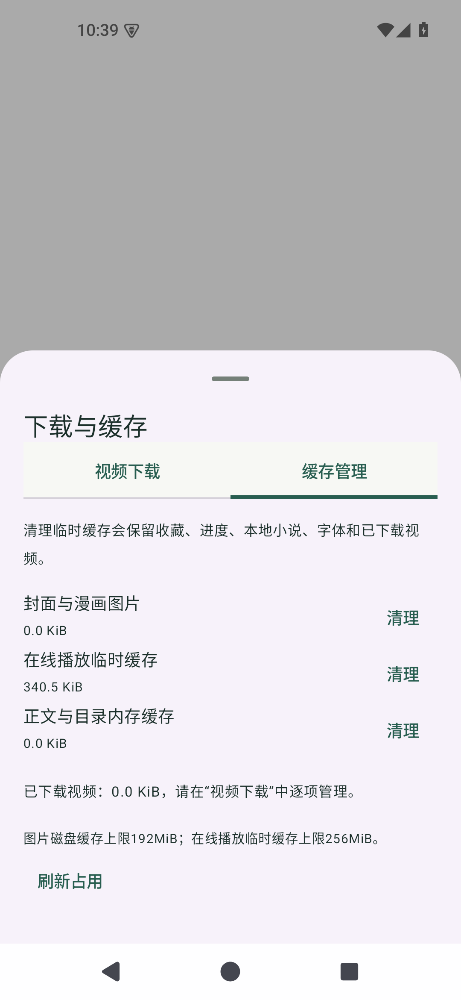
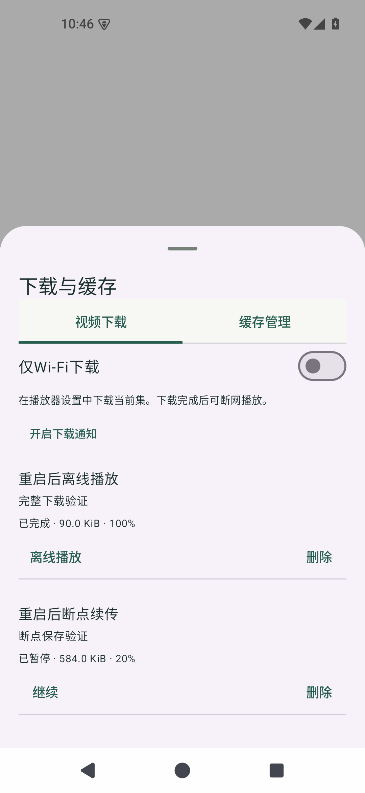
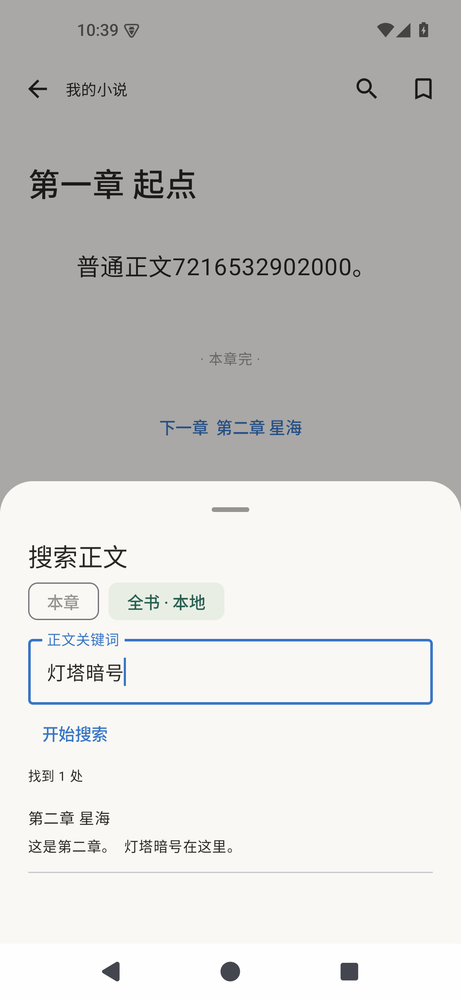
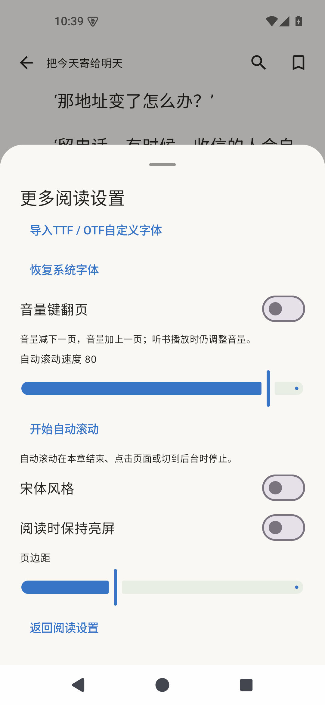

# 0.10.0 实际页面

Android 35模拟器截图。测试作品、视频与服务器仅用于验收，没有预置到App。下载截图中关闭Wi-Fi限制是为了本地测试，App默认开启“仅Wi-Fi下载”。

| 缓存分类清理 | 视频下载与暂停续传 |
| --- | --- |
|  |  |

入口：发现页右上角“＋ → 下载与缓存”。普通缓存清理保留已下载视频、本地小说、字体、收藏与进度。

| 本地小说全文搜索 | 字体、音量键和自动滚动 |
| --- | --- |
|  |  |

阅读时点击正文唤出工具，顶栏放大镜打开正文搜索；“设置 → 更多设置”调整字体、音量键和自动滚动。目录可按章节名筛选。

离线播放使用已经下载的内容；测试验证了服务器停止后的播放，以及结束App进程后的任务恢复。视频画面为受控测试片段。
