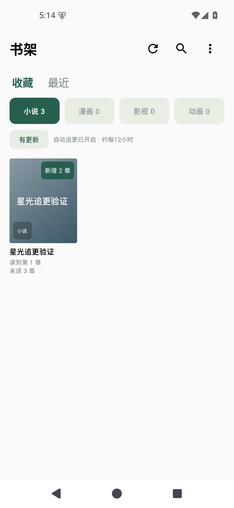
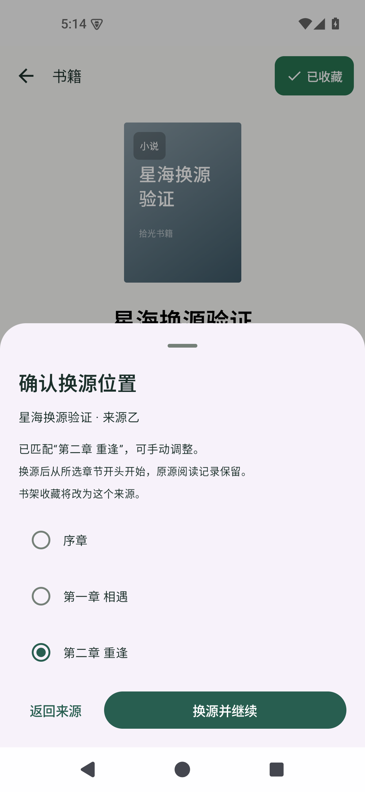
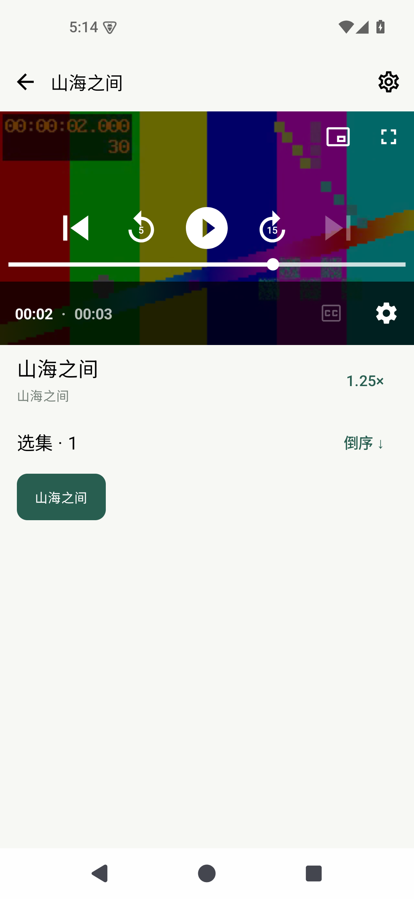
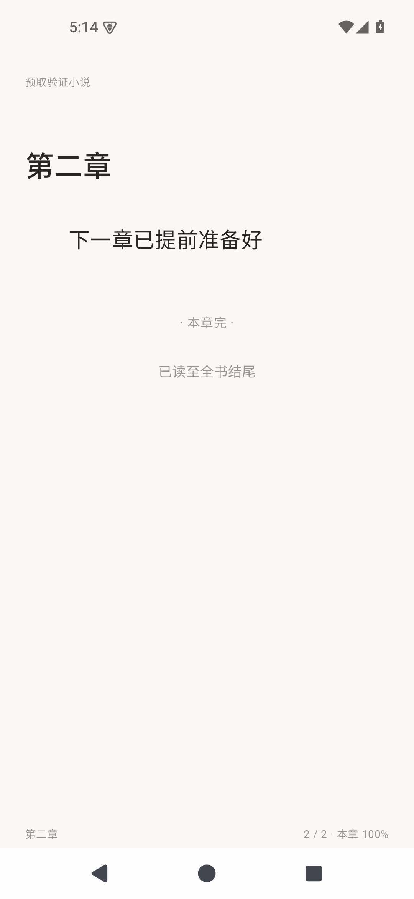

# 拾光 0.9.0 实际页面

以下为 Android 35 模拟器中运行的真实界面，使用临时验证作品和本机测试内容源；这些作品、来源和调试数据未预置到安装包。

| 收藏追更与书架筛选 | 换源位置确认 |
| --- | --- |
|  |  |

| 全屏返回竖屏窗口 | 小说下一章预取 |
| --- | --- |
|  |  |

[漫画图片单张重试后的页面](05-漫画单张重试.png)

小说验证在预取下一章后关闭本机测试服务器，再切换下一章，确认仍能打开；漫画验证只重试失败图片，确认没有重新请求整章。播放器验证全屏返回保持暂停状态及播放位置，并验证双击、长按松手和切后台恢复倍速。
