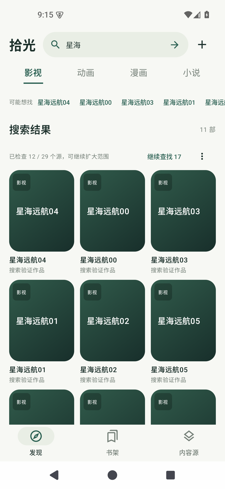

# 0.9.1 搜索与加载优化

Android 35 模拟器实际截图，验证作品与本地测试服务器仅用于验收，未预置到安装包。

| 先显示快源结果，慢源仍在加载 | 漏字搜索命中已见作品 |
| --- | --- |
|  |  |

输入“星远航”可先从本地已见索引找到“星海远航”。未知网站作品仍需网站返回；不表示首次输入任何漏字都能全网命中。

| 首轮受限，可继续扩大范围 | 动画搜索 |
| --- | --- |
|  |  |

“继续查找”每次最多再查24个源；右侧更多菜单可搜索全部剩余源。已完成的来源不重复请求。

| 影视搜索 | 漫画搜索 | 小说搜索 |
| --- | --- | --- |
|  |  |  |

四类均验证快源结果先于对应慢源显示。
