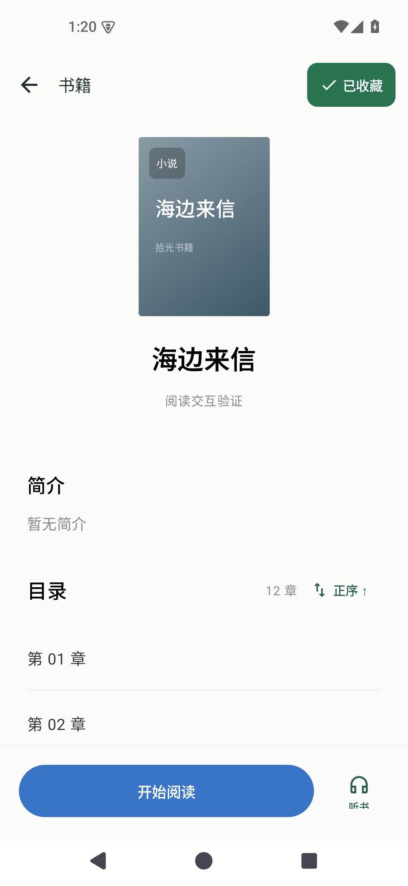
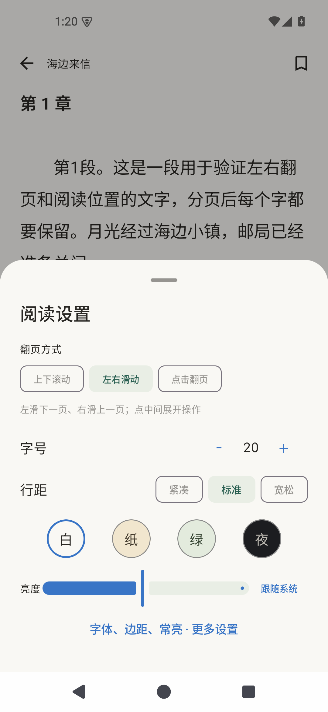
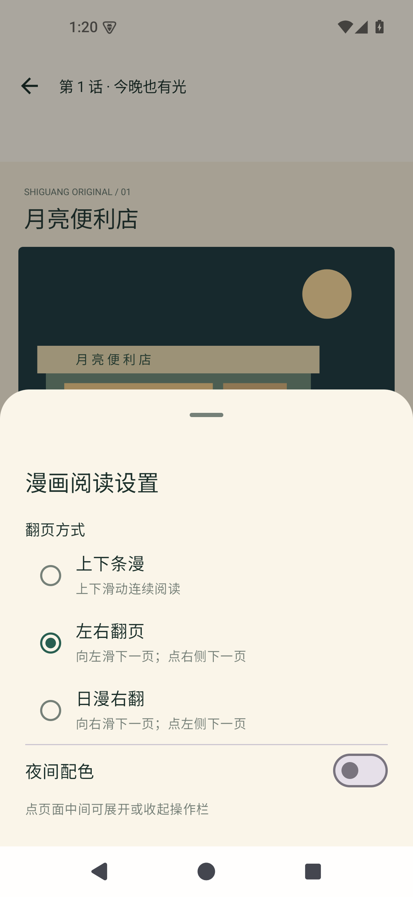
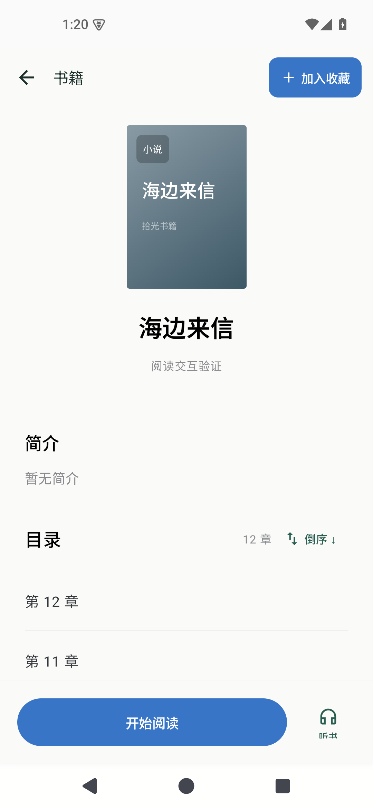
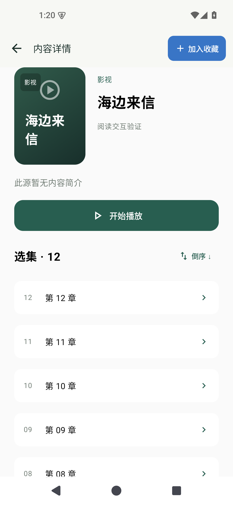

# 拾光页面截图

[查看 0.10.0：缓存管理、小说增强与视频离线下载](0.10.0/README.md)

[查看 0.9.1：四类搜索、少字匹配与搜索范围](0.9.1/README.md)

[查看 0.9.0：追更、换源、播放与阅读优化](0.9.0/README.md)

以下为 0.8.0 收藏状态与翻页设置的历史截图。

Android 35 模拟器实际页面。验收用的临时作品与内容源未预置到安装包。

| 未收藏 | 已收藏 |
| --- | --- |
|  |  |

| 小说翻页设置 | 漫画翻页设置 |
| --- | --- |
|  |  |

| 小说倒序目录 | 视频倒序选集 |
| --- | --- |
|  |  |

[下载安装包及完整截图](https://github.com/xiaolong610/shiguang-android/releases/latest)
